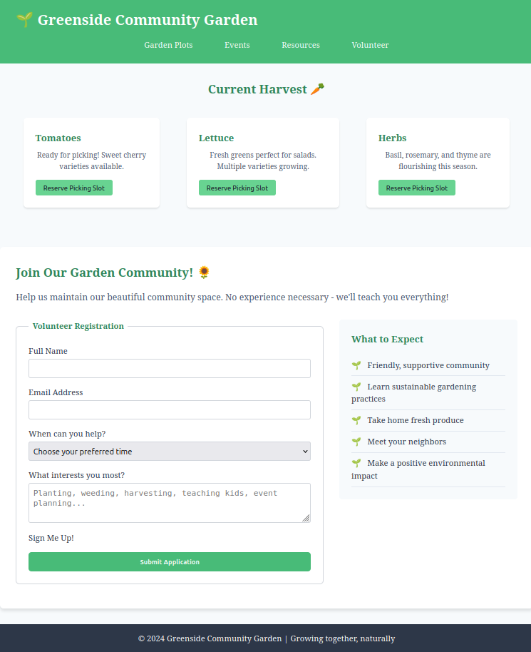
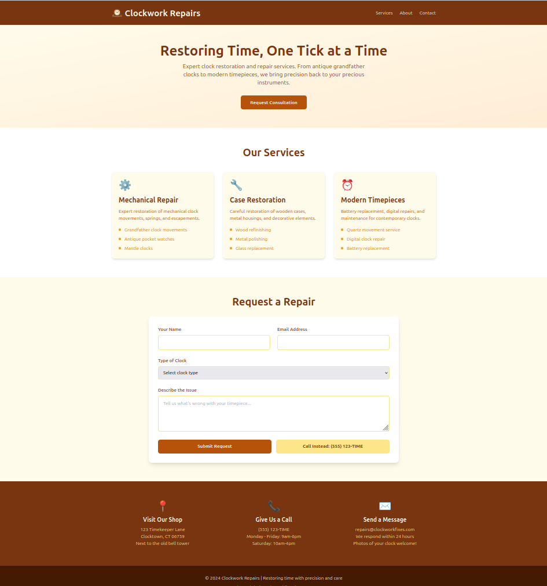
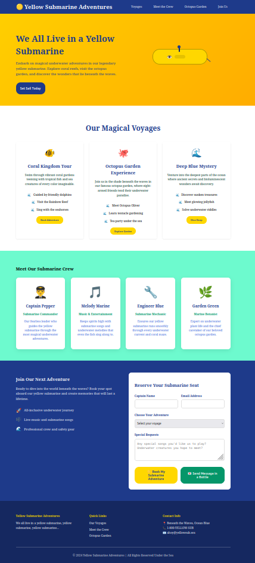

# CSS, Week 4 — CSS Frameworks Debugging: Vanilla CSS, Tailwind and SASS

**Day:** Day 5

**Estimated time:** 3 hours (20 min lesson, then 45 + 55 + 50 min for the three sections, and 10 min to test and submit)

**Block:** CSS · Week 4

---

Three websites are broken, each styled a different way. You'll debug a community garden site written in vanilla CSS, set up Tailwind from scratch for a clock repair shop and fix its broken utility classes, then get a Yellow Submarine site's SASS compiling again. Each section has diagnostic fixes checked by automated tests, followed by a creative improvement challenge.

**Prerequisites:** CSS fundamentals (box model, flexbox, grid, specificity), basic command line use, and this week's SCSS labs.





## How this lab works

```
w2_css_frameworks_fail/
├── lesson/
│   └── index.md              ← Start here. Read this first.
├── lab/
│   ├── instructions.md       ← Then do this. Includes a 3-hour schedule.
│   ├── hints.md              ← Stuck for 5 minutes? One nudge per issue
│   ├── 01-vanilla-css/       ← Section 1: Community Garden (fix broken-styles.css)
│   ├── 02-tailwind/          ← Section 2: Clock Repair Shop (start with SETUP-INSTRUCTIONS.md)
│   ├── 03-sass/              ← Section 3: Yellow Submarine (fix scss/styles.scss)
│   ├── tests/                ← Combined score runner (don't edit)
│   ├── assets/               ← Screenshots of each site
│   ├── package.json          ← Tooling: Tailwind, Sass, tests (you add one script in the Tailwind setup)
│   ├── .puppeteerrc.cjs      ← Test browser settings (don't edit)
│   ├── .prettierrc
│   └── .gitignore
├── lab.json                  ← Submission config (don't edit)
├── submit                    ← Run this when you're done (./submit <your-student-id>)
├── submit.py                 ← The submission script that ./submit runs (don't edit)
└── README.md                 ← You are here
```

You need Node.js 18 or newer (`node --version`). Before you start, run `npm install` once from inside the `lab/` folder (`cd lab`). All `npm run ...` commands in the instructions are run from inside `lab/` too.

> **Note:** The lab files contain intentional errors. Fixing them is the lab.

---

## Step 1 — Read the lesson

Open `lesson/index.md` and read it fully before touching any code.

The lesson explains the concept you're about to practise. Don't skip it — the lab will be much harder without it.

---

## Step 2 — Do the lab

Open `lab/instructions.md` and work through the tasks in order.

Your work goes inside the `lab/` directory. Do not modify files outside of it.

---

## Step 3 — Submit

When all tasks are complete, run this from the project root (not from `lab/`):

```bash
./submit <your-student-id>
```

On Windows without Git Bash, run `python submit.py <your-student-id>` instead (or `python3`, depending on your install).

This runs the tests for all three sections (34 checks) and records your score in Canvas. The qualitative improvements are reviewed by your mentor. You can submit multiple times — the most recent submission counts.

---

## Getting stuck

1. Re-read the relevant section of the lesson
2. Check the "Common mistakes" table in the lesson
3. Search the error message — copy it exactly into Google or your AI tool
4. Ask in the group chat — share your error message and what you've already tried
5. Escalate to your mentor only if steps 1–4 haven't resolved it

---

## This week's focus

> "Turn plain CSS into maintainable preprocessor code — SCSS variables, mixins and partials, a first look at LESS — and learn to diagnose and fix preprocessor mistakes."
