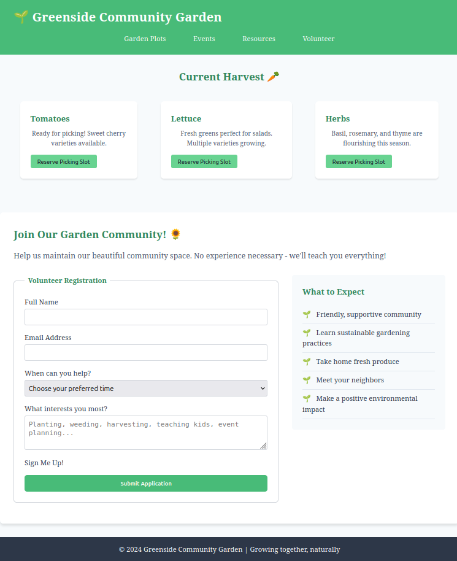
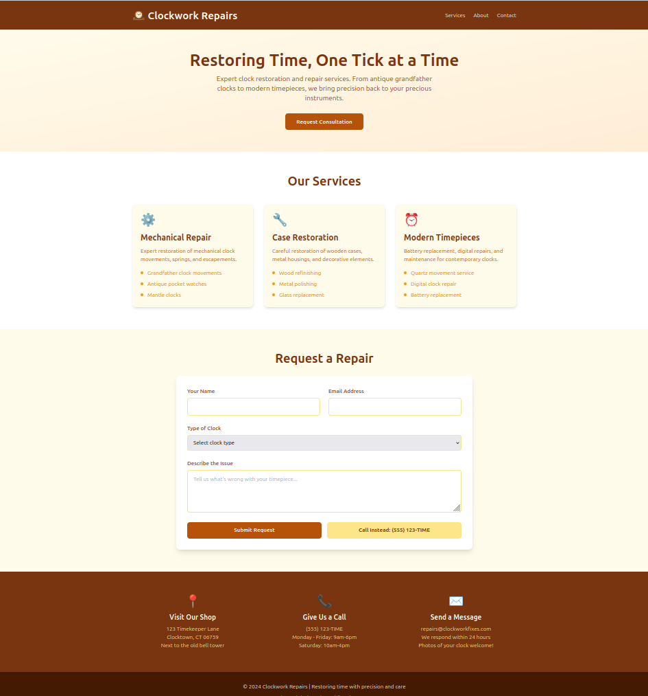
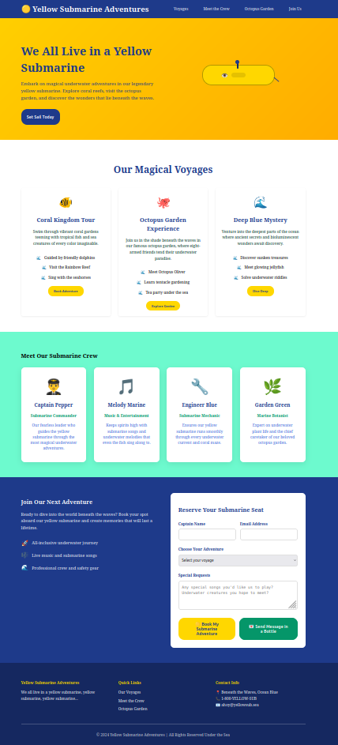

# CSS Frameworks Debugging Lab - Instructions

> **CSS · Week 4 · Day 5**. Read `lesson/index.md` before starting.

You'll work through three sections, each using a different approach to styling a web project:

1. **Vanilla CSS** (45 min) - Community Garden theme
2. **Tailwind CSS** (55 min) - Clock Repair Shop theme
3. **SASS/SCSS** (50 min) - Yellow Submarine theme

Each section has **diagnostic fixes** (specific broken code to debug, checked by automated tests) and **qualitative improvements** (creative enhancements that make the sites better, reviewed by your mentor).

The diagnostic comments describe what looks wrong, not how to fix it. Finding the cause is the skill you're practising, so use DevTools, the compiler's error messages and the lesson.





## Your 3 hours

| Time | Block | What to do |
|---|---|---|
| 0:00–0:20 | Lesson | Read `lesson/index.md` and answer its check questions |
| 0:20–0:50 | Section 1 | Vanilla CSS: fix the 10 diagnostic issues |
| 0:50–1:05 | Section 1 | Vanilla CSS: 3 design tasks |
| 1:05–1:35 | Section 2 | Tailwind setup (`SETUP-INSTRUCTIONS.md`) |
| 1:35–2:00 | Section 2 | Tailwind: fix the 8 diagnostic issues |
| 2:00–2:35 | Section 3 | SASS: fix the 10 diagnostic issues |
| 2:35–2:50 | Section 3 | SASS: 2 design tasks |
| 2:50–3:00 | Submit | Run `npm test`, then `./submit` from the project root |

**Keep to the clock:**
- Stuck on one issue for **5 minutes**? Open [`hints.md`](hints.md) and read the hint for that issue only.
- Still stuck after the hint? Note the issue number, move on, and come back at the end. Every section is graded separately, so skipping one issue doesn't block the next.
- Behind schedule at a checkpoint? Skip the design tasks and come back to them if there's time. The diagnostic fixes are what the tests grade.

## Prerequisites

Before beginning, ensure you have:
- Completed HTML and CSS fundamentals
- Basic command line familiarity
- Node.js and npm installed on your machine
- Code editor

## Lab Details

### Section 1: Vanilla CSS Debugging (45 minutes)
**Theme:** 🌱 Community Garden Website

**What you'll do:**
- Fix 10 diagnostic CSS issues (broken properties, missing units, the cascade, layout) (30 min)
- Make the volunteer section match the finished design: 3 short design tasks (15 min)
- Practice core CSS concepts: flexbox, grid, positioning, specificity

**Key Skills:**
- CSS property names and syntax
- Box model and layout debugging
- Specificity and cascade understanding

---

### Section 2: Tailwind CSS Setup & Debugging (55 minutes)
**Theme:** 🕰️ Clock Repair Shop Website

**What you'll do:**
- **Setup Phase (30 min):** Configure Tailwind CSS build process with detailed guidance
- **Diagnostic Phase (25 min):** Fix 8 broken or missing Tailwind classes
- Learn utility-first CSS approach through hands-on practice

**Key Skills:**
- Package management with npm
- CSS build processes and watch commands
- Utility-first CSS methodology
- Command line comfort building

---

### Section 3: SASS Debugging & Organization (50 minutes)
**Theme:** 🟡 Yellow Submarine Adventures Website

**What you'll do:**
- Fix 10 SASS issues: 7 that stop the compiler and 3 that compile but look wrong (variables, mixins, functions, nesting, `&`, `@extend`, `@use`) (35 min)
- Theme the buttons with one reusable mixin and style the section titles (15 min)
- Learn CSS preprocessing benefits through practical application

**Key Skills:**
- SASS/SCSS syntax and compilation
- CSS organization with variables, mixins, and functions
- Advanced CSS features and preprocessing benefits

## Setup Instructions

**Note**: Run all `npm` commands from inside the `lab/` folder (`cd lab` from the project root).

1. **Install dependencies** once, from inside `lab/`:
   ```bash
   cd lab
   npm install
   ```
2. **Start with Section 1 (Vanilla CSS):**
   - Open `01-vanilla-css/broken-styles.css` in your code editor (The instructions are in this file)
3. **Continue to Section 2 (Tailwind CSS):**
   - Follow the setup instructions in `02-tailwind/SETUP-INSTRUCTIONS.md`
   - Once you have Tailwind configured, open `02-tailwind/index.html` in your editor -- you will find instructions here.
4. **Finish with Section 3 (SASS):**
   - Open `03-sass/scss/styles.scss` in your code editor, where you will find instructions.
   - Compile your SCSS with `npm run build:sass` (once) or `npm run watch:sass` (recompiles every time you save, Ctrl+C to stop).

## Working Through Each Section

### Recommended Approach
1. **Read the section instructions** thoroughly before starting
2. **Follow setup instructions** carefully (especially for Tailwind)
3. **Fix diagnostic issues first** - these are specific problems to solve
4. **Run tests frequently** to check your progress:
   ```bash
   npm run test:vanilla    # Test vanilla CSS fixes
   npm run test:tailwind   # Test Tailwind fixes
   npm run test:sass       # Test SASS fixes
   ```
5. **Work on qualitative improvements** after diagnostic issues are fixed

### Getting Help
- **Read error messages from `npm run test` carefully** - they often contain the solution
- **Check the diagnostic comments** in each file - they provide hints
- **Use the browser developer tools** to inspect elements and styles
- **Ask questions** if you get stuck - learning happens through problem-solving!

## Testing Your Work

Each section includes automated tests to check your diagnostic fixes. **Run these commands from inside `lab/`**:

```bash
# Test individual sections
npm run test:vanilla
npm run test:tailwind
npm run test:sass

# Test everything at once
npm run test:all

# Show your overall score (this is what ./submit runs)
npm test
```

**How the tests check your work:**
- **Tailwind:** the setup checks look at your files and your `dist/output.css`. The diagnostic checks build a fresh copy of the CSS from your `index.html`, so they don't depend on your watch command still running.
- **SASS:** the tests compile `scss/styles.scss` themselves. Run `npm run build:sass` to see your changes in the browser.
- The qualitative improvements aren't graded by the tests. Your mentor reviews them.

**Understanding Test Results:**
- ✅ **Green checkmarks** = Issue fixed correctly
- ❌ **Red X marks** = Issue still needs fixing
- 💡 **Hints provided** for failing tests

## File Structure Reference

### 📁 01-vanilla-css/
- `index.html` - Community garden website with linked CSS
- `broken-styles.css` - Contains 10 diagnostic issues to fix and a "Qualitative" improvement challenge
- `test-diagnostic.js` - Automated tests for your diagnostic fixes

### 📁 02-tailwind/
- `index.html` - Clock repair shop website (contains 8 diagnostic issues and instructions that should be done AFTER following the setup instructions)
- `SETUP-INSTRUCTIONS.md` - Step-by-step Tailwind CSS setup guide (This should be the starting point for this section)
- `test-diagnostic.js` - Automated tests for your diagnostic fixes

### 📁 03-sass/
- `index.html` - Yellow submarine website
- `scss/styles.scss` - SASS file with 10 issues to fix and a "Qualitative" improvement challenge
- `scss/partials/` - Organized SASS partials
- `css/` - Compiled CSS output (created the first time you run `npm run build:sass`)
- `test-diagnostic.js` - Automated tests for your diagnostic fixes

## Learning Outcomes

After completing this lab, you should feel confident:

- **Debugging CSS issues** systematically and efficiently
- **Understanding different CSS approaches** and when to use them
- **Working with build tools** and command-line processes
- **Organizing CSS code** for maintainability and scalability
- **Connecting fundamental concepts** across different tools and frameworks

---

**Happy debugging! 🐛→✨**

*Need help? Check hints in diagnostic comments, review error messages carefully, use browser developer tools, or re-read the "Common mistakes" table in the lesson.*
